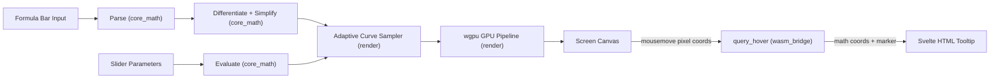
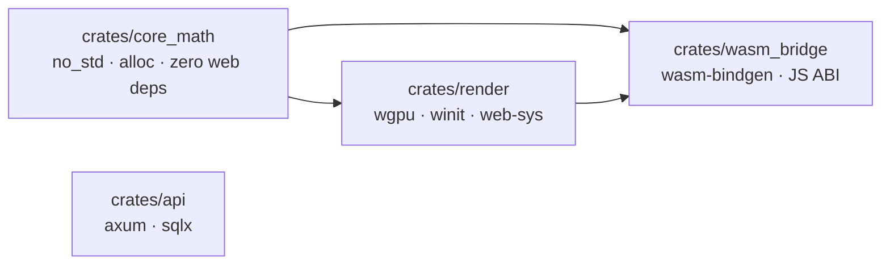

# Architecture Spine — GeoGebra RS

## Design Paradigm

**Pipes-and-Filters with a strict Client-Compute boundary.**

Raw user input flows through a defined pipeline of independent, substitutable stages — `Parse → Differentiate/Simplify → Sample → Submit to GPU` — each stage consuming only the output of the previous one and owning no global state. The Axum backend is deliberately kept outside this pipeline; it is a dumb JSON blob store that only sees serialized snapshots, never live math state.



## Invariants & Rules

### AD-1 — 4-Crate Workspace Boundary

- **Binds:** all crates, Cargo.toml workspace membership
- **Prevents:** math engine logic tangled with wgpu or wasm-bindgen types; prevents inability to unit-test calculus in native `cargo test` without WASM toolchain
- **Rule:** The Cargo workspace contains exactly four crates: `crates/core_math`, `crates/render`, `crates/wasm_bridge`, `crates/api`. Dependency direction is one-way: `core_math ← render ← wasm_bridge`; `api` is independent. No crate may create a reverse or cross dependency.



### AD-2 — Zero-Dependency Pratt Parser & AST Evaluation

- **Binds:** `crates/core_math` — parsing and evaluation modules
- **Prevents:** two builders choosing different AST representations or pulling in conflicting parser combinator crates; prevents inability to attach exact character spans to error diagnostics
- **Rule:** `core_math` implements its own Pratt parser (no external parsing crate). Every AST node and parse error carries `Span { start: usize, end: usize }` over the input byte slice. Evaluation is recursive tree-walk (`expr.eval(x, &params) -> f64`); no bytecode VM or JIT for MVP.

### AD-3 — Symbolic Differentiation with Mandatory AST Canonicalization

- **Binds:** `crates/core_math` — `differentiate`, `simplify` functions
- **Prevents:** unbounded AST growth on repeated differentiation; prevents silently divergent curve plots from unexpanded constant sub-trees
- **Rule:** Every call to `differentiate(expr) -> Expr` must be immediately followed by `simplify(expr) -> Expr` before any further derivation or evaluation. Simplification applies constant folding, identity elimination, and sign normalization. The root-finding and extrema pipeline identifies sign changes on sampled intervals then refines with Brent's method; it must distinguish infinite-discontinuity sign jumps (slope magnitude $> \text{POLE\_THRESHOLD}$ with divergent magnitude) from true zeros before emitting markers.

### AD-4 — GPU Renders Geometry; Svelte Renders Text & Tooltips

- **Binds:** `crates/render`, `crates/wasm_bridge`, Svelte 5 frontend
- **Prevents:** text font atlas bloat in WASM binary; prevents `wgpu` line-width limitation producing 1-px hairlines for curves and derivative overlays
- **Rule:** `render` draws all geometric content (curves as quad-ribbon triangle strips expanded in WGSL vertex shader, coordinate grid, asymptote dashed lines) on the `<canvas>`. Svelte renders all text (axis tick labels, formula annotations, hover tooltips) as a transparent DOM/SVG layer positioned over the canvas. All analysis markers (roots/extrema/inflection) are DOM buttons for keyboard/focus with 44px hit padding; the canvas carries `role="img"` with a text fallback. On `mousemove`, Svelte calls `query_hover(px_x, px_y)` on the WASM bridge and displays the returned `{ math_x, math_y, marker }` as an HTML tooltip — it never performs spatial math itself. `wgpu` must request backends `PRIMARY | GL`; if WebGPU adapter fails, silently retry with a WebGL2 adapter.
- **Amendment 2026-10-19 (UX function-explorer reconciliation):** curves + grid stay on canvas/wgpu per AD-4; there is no canvas-only exception for markers even for dense clusters — the extra overlay sync cost at 60 FPS is accepted. Multi-curve infra remains invariant (per-function style, dashed derived curves); the UX run constrains to a single primary plus auto-displayed derived `f`/`f'`/`f''`/tangent — the multi-function set is deferred, not forbidden (see Deferred). Derived curves `f'`/`f''`/tangent auto-render dashed (green/purple/amber) alongside solid indigo `f`; toggles are canvas-only re-render and never refire analysis. Constraining companions: `_bmad-output/initiative-geogebra-rs/ux-function-explorer/DESIGN.md` and `_bmad-output/initiative-geogebra-rs/ux-function-explorer/EXPERIENCE.md`.

### AD-5 — WASM ABI: Named Surface Functions Only

- **Binds:** `crates/wasm_bridge` — all `#[wasm_bindgen]` exports
- **Prevents:** Svelte coupling directly to internal `Expr` or `Viewport` Rust types; prevents unbounded growth of WASM surface area
- **Rule:** The public WASM API is exactly these five entry points (any expansion requires an explicit AD amendment):

  | Function | Signature | Returns |
  | :--- | :--- | :--- |
  | `parse_and_validate` | `(formula: &str)` | `Result<ParseOk, ParseErr>` |
  | `set_function` | `(id: &str, formula: &str)` | `()` |
  | `update_param` | `(key: &str, value: f64)` | `()` |
  | `update_viewport` | `(x_min: f64, x_max: f64, y_min: f64, y_max: f64)` | `()` |
  | `query_hover` | `(px_x: f64, px_y: f64)` | `HoverResult` |

  All types crossing the boundary are `#[wasm_bindgen]` structs with `pub` fields or serialize to plain JSON. Rust owns all live math, GPU state, and viewport state; Svelte sets the viewport by calling `update_viewport` and reads it back only through serialized workspace JSON — it never holds a parallel authoritative copy.
- **Amendment 2026-10-19 (UX function-explorer reconciliation):** Rust `wasm_bridge` owns all spatial math via `query_hover`; the Svelte overlay only positions the tooltip and never caches spatial results. `update_param` triggers an eval-only re-render without refiring `differentiate`/`simplify`, holding the 8 ms / 60 FPS budget — param-slider drags re-render curves + values, symbolic analysis fires only on Analyze.

### AD-6 — Axum as Unauthenticated JSON Blob Store

- **Binds:** `crates/api`, Axum route handlers, workspace JSON schema
- **Prevents:** backend expanding into math compute, auth, or workspace mutation logic; prevents workspace schema drift between save and load
- **Rule:** Axum exposes exactly two routes: `POST /api/workspaces` (stores JSON blob, returns 8-character URL-safe slug) and `GET /api/workspaces/:slug` (returns stored blob). Payload size is hard-limited to 64 KB at the middleware layer. Workspace JSON must include a `"version": <integer>` field for forward compatibility. No math evaluation, no authentication, no mutation endpoints in MVP.

## Consistency Conventions

| Concern | Convention |
| :--- | :--- |
| Crate naming | Snake-case: `core_math`, `wasm_bridge` |
| Math coordinate types | `f64` throughout; no `f32` in `core_math` (precision constraint NFR-FUNC-01) |
| Error shapes | `core_math` errors carry `Span { start, end }` + `message: String`; WASM bridge serializes to `{ span: [start, end], message }` |
| Workspace slug | 8 characters, URL-safe Base64 alphabet (`[A-Za-z0-9_-]`) |
| Viewport state | Owned by `wasm_bridge` session struct; serialized as `{ x_min, x_max, y_min, y_max }` f64 fields |
| Shader source | WGSL only; no GLSL — `wgpu` compiles to SPIR-V / GL internally |
| Parameter map | `HashMap<String, f64>` passed by reference into `eval`; no global mutable state |

## Stack

| Name | Version | Role |
| :--- | :--- | :--- |
| Rust | 2024 edition | All crates |
| `wgpu` | 30.0.1 | GPU rendering (WebGPU + WebGL2 fallback) |
| `wasm-bindgen` | 0.2.129 | JS ↔ WASM ABI bridge |
| `axum` | 0.8.9 (pinned) | REST API server |
| `sqlx` | 0.9.0 (pinned) | Async DB access (SQLite or PostgreSQL) |
| `serde` + `serde_json` | 1.x | Workspace JSON serialization |
| Svelte | 5 (Runes GA) | Reactive UI, sliders, tooltip overlay |

## Structural Seed

```text
geogebra-rs/
  Cargo.toml               # workspace: members = [crates/core_math, crates/render, crates/wasm_bridge, crates/api]
  crates/
    core_math/             # Pure math: AST, Pratt parser, evaluator, differentiator, simplifier, Brent solver
      src/
        ast.rs             # Expr enum, Span struct
        lexer.rs           # Character-level tokenizer
        parser.rs          # Pratt parser → Expr
        eval.rs            # Recursive tree-walk evaluator
        diff.rs            # Symbolic differentiation rules
        simplify.rs        # Constant folding + identity elimination
        solver.rs          # Brent's method, sign-change bracketing
    render/                # wgpu pipeline, shaders, viewport, adaptive sampler
      src/
        pipeline.rs        # wgpu device/surface init with WebGL2 fallback
        curve.rs           # Adaptive sampler → VertexBuffer; pole/asymptote guard
        grid.rs            # Coordinate grid and axis shader
      shaders/
        curve.wgsl         # Quad ribbon vertex + AA fragment shader
        grid.wgsl          # Grid line shader
    wasm_bridge/           # #[wasm_bindgen] exports, JS event wiring
      src/
        lib.rs             # parse_and_validate, set_function, update_param, query_hover
    api/                   # Axum REST server
      src/
        main.rs
        routes.rs          # POST /api/workspaces, GET /api/workspaces/:slug
        store.rs           # sqlx workspace persistence
  frontend/                # Svelte 5 app
    src/
      App.svelte
      FormulaBar.svelte    # Input + error span highlighting
      Canvas.svelte        # <canvas> mount + wasm_bridge calls
      Tooltip.svelte       # Hover tooltip positioned over canvas
      Sliders.svelte       # Reactive parameter sliders
```

## Capability → Architecture Map

| Capability | Lives in | Governed by |
| :--- | :--- | :--- |
| R1 – Parse expressions with error spans | `core_math/parser.rs`, `lexer.rs` | AD-2, AD-5 |
| R2 – Dynamic parameter sliders | `core_math/eval.rs` (params map), `Sliders.svelte` | AD-4, AD-5 |
| R3 – Symbolic 1st & 2nd derivatives | `core_math/diff.rs` + `simplify.rs` | AD-3 |
| R4 – Real-time tangent line at x₀ | `core_math/eval.rs`, `render/curve.rs` | AD-3, AD-4 |
| R5 – Root detection via Brent's method | `core_math/solver.rs` | AD-3 |
| R6 – Extrema & inflection points | `core_math/solver.rs` (on f', f'') | AD-3 |
| R7 – Asymptote guard / pole detection | `render/curve.rs` (pole threshold filter) | AD-3, AD-4 |
| R8 – Adaptive sampling, 8ms budget | `render/curve.rs` (curvature subdivision) | AD-4 |
| R9 – 60 FPS pan & zoom | `render/pipeline.rs`, `render/grid.rs` | AD-4 |
| R10 – Multi-curve colours & dashes | `render/curve.rs` (per-function style), `curve.wgsl` | AD-4 |
| R11 – Workspace JSON serialization | `wasm_bridge/lib.rs` + `serde_json` | AD-5, AD-6 |
| R12 – REST save/load < 50ms | `api/routes.rs`, `api/store.rs` | AD-6 |
| Hover tooltip | `wasm_bridge` `query_hover`, `Tooltip.svelte` | AD-4, AD-5 |

## Deferred

- **Multi-function set:** the UX run constrains to a single primary function plus auto-displayed derived `f`/`f'`/`f''`/tangent; the multi-function set is deferred, not forbidden — AD-4 per-function style infra already covers it when re-enabled.
- **Native desktop binary:** `render` crate targets `winit` + native `wgpu` adapter for a Raylib-style desktop build. Deferred to post-MVP; the crate boundary makes this additive.
- **Implicit / parametric curves:** Require a 2D marching-squares evaluator. Not in MVP scope; nothing here prevents adding it as a filter stage.
- **Workspace link expiry:** Storage TTL policy (e.g., 90-day retention). Backend concern, deferred until hosting infra is chosen.
- **SVG export:** WASM-side vector rasterization. Deferred post-MVP.
- **Per-story test architecture:** Unit test structure within each crate, integration test harness shape, CI pipeline. Deferred to epic-level spines.
- **Hosting & deployment:** Provider, containerisation, environment strategy. Deferred to infrastructure epic.
