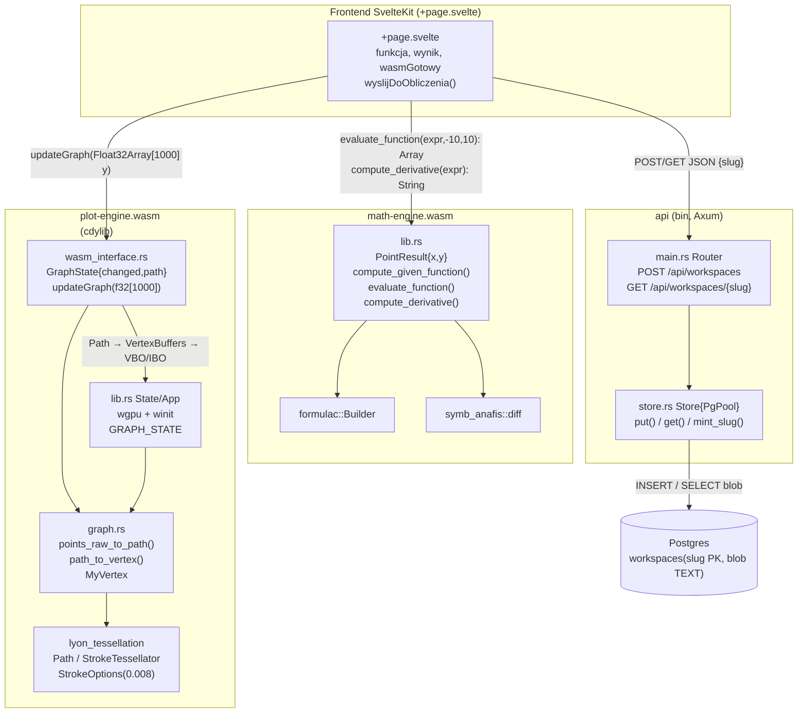
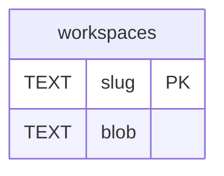
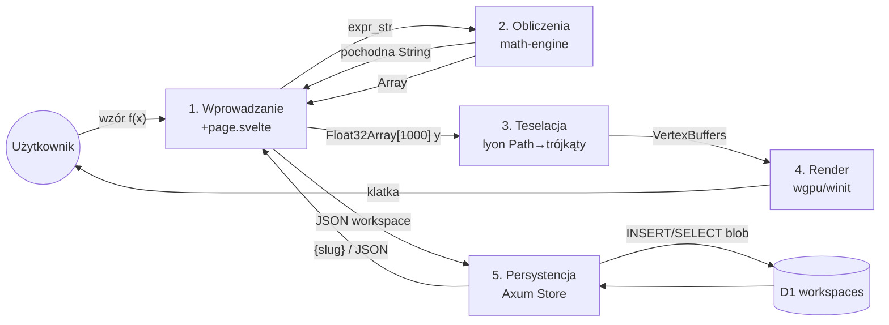

# Diagramy architektury GeoGebra

---

## 1. Widok deweloperski — UML Component Diagram

Wybrano wariant deweloperski (zamiast logicznego Class), bo istotą ADR jest podział na crate'y / moduły WASM.

---

## 2. Widok procesu — UML Communication Diagram (współpraca obiektów, ten sam przepływ)

---

## 3a. Diagram danych — ERD

`migrations/20261027000000_create_workspaces.sql:1-4`. Jedna tabela, bez FK. `slug` — 8 znaków `[A-Za-z0-9-_]` (`store.rs:11-15`, `routes.rs:11`), `blob` — `serde_json::Value` serializowany do TEXT (`store.rs:72,93`). Brak `created_at/expires_at`, brak `JSONB`, brak wersji schematu — stąd otwarta retencja z PRD.

---

## 3b. Diagram danych — DFD poziom 0/1

