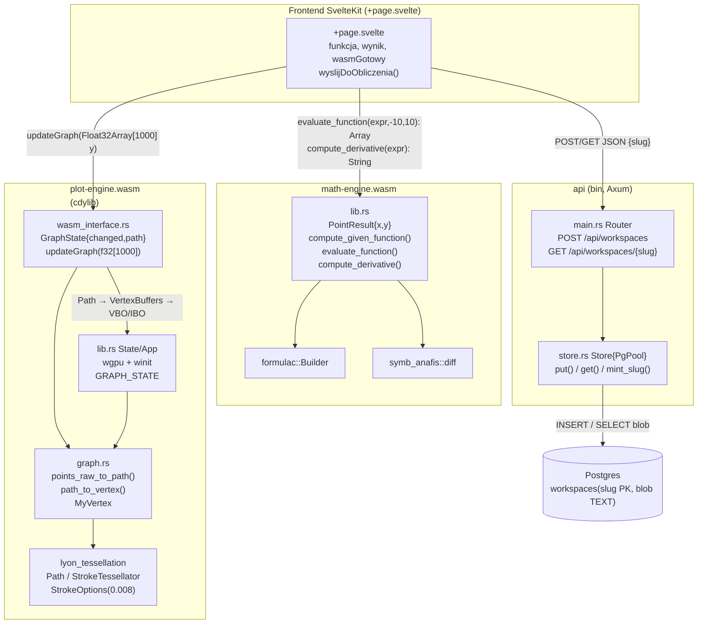
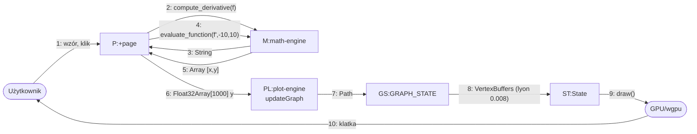
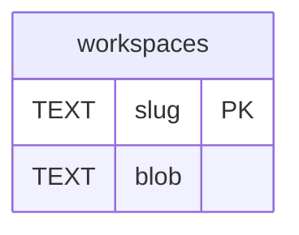
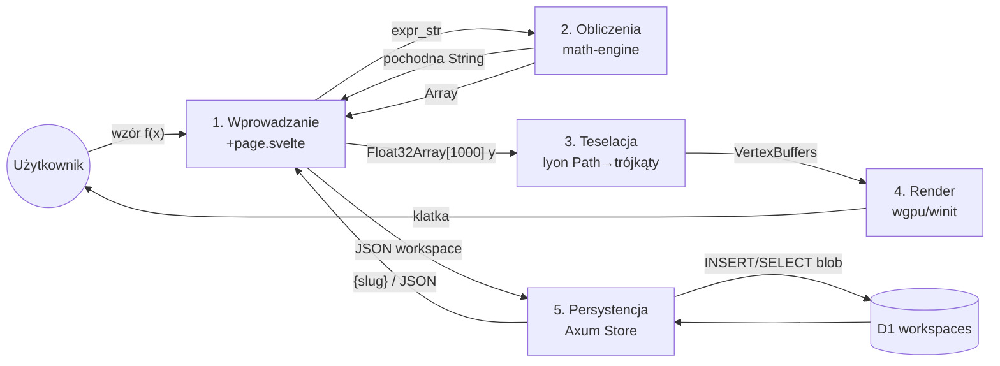

# Diagramy architektury GeoGebra RS (stan faktyczny z kodu)

> Źródła: `crates/math-engine/src/lib.rs`, `crates/plot-engine/src/{lib.rs,graph.rs,wasm_interface.rs}`, `frontend/src/routes/+page.svelte`, `crates/api/src/{main.rs,routes.rs,store.rs}`, `migrations/20261027000000_create_workspaces.sql`

---

## 1. Widok deweloperski — UML Component Diagram

Wybrano wariant deweloperski (zamiast logicznego Class), bo istotą ADR jest podział na crate'y / moduły WASM.



Mapa na kod: `+page.svelte:55-65` spina oba WASM-y; `wasm_interface.rs:12-13` wymaga dokładnie 1000 `f32`; `graph.rs:15,31` to granica Path/teselacja; `store.rs:71,91` to granica SQL.

---

## 2a. Widok procesu — UML Sequence Diagram (główny przepływ: wzór → wykres)

```mermaid
sequenceDiagram
    actor U as Użytkownik
    participant P as +page.svelte
    participant M as math-engine.wasm
    participant PL as plot-engine.wasm
    participant G as GRAPH_STATE + State
    participant GPU as wgpu/GPU

    U->>P: wpisuje funkcja + klik (wyslijDoObliczenia)
    P->>M: compute_derivative(funkcja)
    M-->>P: String pochodna
    P->>M: evaluate_function(pochodna, -10, 10)
    Note over M: Builder::compile + próbkowanie 1000 pkt<br/>normalizacja do [-1,1], PointResult[]
    M-->>P: js Array<PointResult>
    P->>P: Float32Array[1000] tylko y (pętla i<1000)
    P->>PL: updateGraph(f32[1000])
    PL->>G: points_raw_to_path() → path; changed=true
    G->>G: State::update(): path_to_vertex()<br/>StrokeTessellator → VBO/IBO
    G->>GPU: draw grid(LineList) + graph(TriangleList)
    GPU-->>U: klatka canvas#canvas
```

Wariant share (API): `P ->> API: POST /api/workspaces JSON` → `Store.put(): mint_slug + INSERT` → `DB` → `{slug}`; odczyt symetrycznie `GET /:slug → Store.get(): SELECT → JSON / 404` (`routes.rs:17,40`, `store.rs:71,91`).

---

## 2b. Widok procesu — UML Communication Diagram (współpraca obiektów, ten sam przepływ)



Numeracja = kolejność wywołań. Obiekty `M` i `PL` nie komunikują się bezpośrednio — wszystko przez `P` (JS). `GS.changed` to flaga pollingu w `State::update`.

---

## 3a. Diagram danych — ERD



`migrations/20261027000000_create_workspaces.sql:1-4`. Jedna tabela, bez FK. `slug` — 8 znaków `[A-Za-z0-9-_]` (`store.rs:11-15`, `routes.rs:11`), `blob` — `serde_json::Value` serializowany do TEXT (`store.rs:72,93`). Brak `created_at/expires_at`, brak `JSONB`, brak wersji schematu — stąd otwarta retencja z PRD.

---

## 3b. Diagram danych — DFD poziom 0/1



Magazyn tylko `D1`. Przepływy `2→1` i `5→1` wracają do UI. Brak przepływu matematyki do backendu (thin-persistence).
