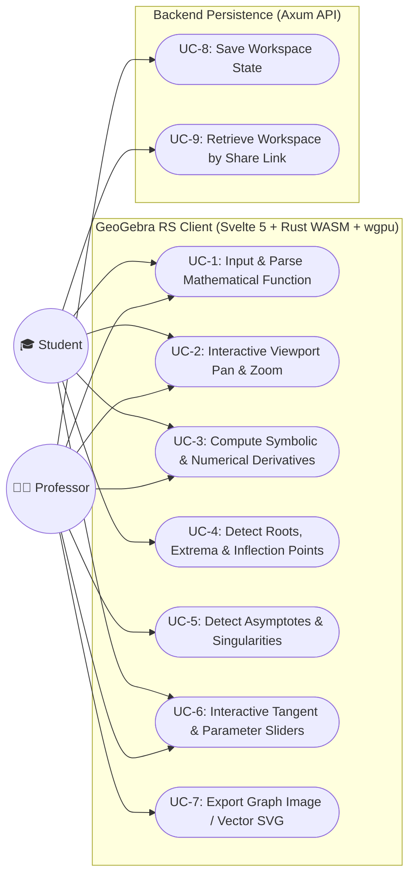
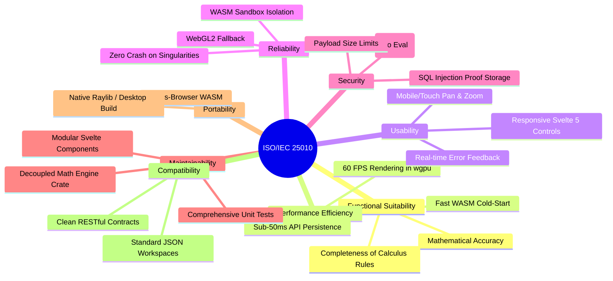

# PRD: GeoGebra RS (Mathematical Analysis & Visualization Platform)

## 0. Document Purpose
This document establishes the product and technical requirements for **GeoGebra RS**, an interactive, high-performance mathematical exploration platform. It translates user needs from students and mathematics educators into formal Functional Requirements (FRs), 5 core INVEST user stories with Given-When-Then criteria, UML use-case definitions, and non-functional requirements structured under the **ISO/IEC 25010 Software Quality Standard**.

Downstream consumers include:
- System Architecture (`bmad-architecture` / Winston)
- UX Specifications (`bmad-ux` / Sally)
- Backlog Slicing & Implementation (`bmad-agent-po` Sofia, `bmad-agent-dev` Amelia)
- Quality Assurance & ATDD (`bmad-tea` Murat)

---

## 1. Vision
Existing computer algebra and graphing systems either suffer from server latency, require heavy desktop installations, or place step-by-step calculus insights behind paywalls. 

**GeoGebra RS** provides instantaneous, zero-latency mathematical visualization and analytical calculus tools directly in the browser and native desktop. By offloading 100% of mathematical computation to client-side WebAssembly (compiled from high-performance Rust) and hardware-accelerated `wgpu` rendering, GeoGebra RS delivers fluid 60 FPS plotting and immediate symbolic differentiation. The backend (Axum) is deliberately kept thin, acting strictly as a lightweight persistence engine for sharing and storing workspaces.

---

## 2. Target Users & Personas

### 2.1 Persona 1: Alex / Piotr (STEM Student)
* **Demographics:** University undergraduate or high school calculus student.
* **Context:** Preparing for calculus examinations, completing problem sets, or attempting to visualize abstract functions (continuity, limits, curvature).
* **Jobs To Be Done (JTBD):**
  - Quickly plot complex functions without configuration or syntax headaches.
  - Understand *why* an extremum or inflection point occurs by viewing the function alongside its derivatives.
  - Run dynamic experiments using variable sliders ($k, a, b$) with zero lag.
* **Frustrations:** Slow web plotters, laggy slider feedback, server timeouts on bad campus Wi-Fi, complex syntax error messages.

### 2.2 Persona 2: Dr. Nowak / Prof. Elena (Mathematics Lecturer)
* **Demographics:** University mathematics lecturer or high school educator.
* **Context:** Presenting calculus concepts on a lecture projector, creating visual problem sets, or demonstrating limits and asymptotes in real time.
* **Jobs To Be Done (JTBD):**
  - Live-demonstrate mathematical concepts (e.g., tangent lines approaching a curve, behavior at asymptotes) with 60 FPS smoothness.
  - Generate clean, mathematically rigorous plots with key features (roots, extrema, inflection points) labeled automatically.
  - Save a customized workspace state and distribute a shareable shortlink to hundreds of students instantly.
* **Frustrations:** Tools that fail on edge cases (e.g., vertical asymptotes producing erroneous vertical connecting lines, removable singularities not indicated), slow cloud save/load workflows.

---

## 3. User Stories (INVEST & GIVEN-WHEN-THEN)

These 5 core user stories satisfy the **INVEST** guidelines (Independent, Negotiable, Valuable, Estimable, Small, Testable) and define the foundational scope of GeoGebra RS.

### Story 1: Function Plotting & Smooth Viewport Navigation
> **As a** student or lecturer,  
> **I want to** enter an analytical function and smoothly zoom/pan around the coordinate plane,  
> **So that** I can intuitively explore the function's local and global behavior.
* **Acceptance Criteria (GIVEN-WHEN-THEN):**
  - **Given** an active GeoGebra RS session,
  - **When** the user types `f(x) = x^3 - 3*x + 1` into the formula bar and presses Enter,
  - **Then** the `wgpu` canvas renders the continuous curve over the current viewport within 16 ms ($< 1$ frame), dynamically adjusting the grid subdivisions and axis tick labels as the user scrolls to zoom or drags to pan.

### Story 2: First & Second Derivative Derivation with Tangent Inspection
> **As a** calculus student,  
> **I want to** automatically calculate $f'(x)$ and $f''(x)$ and inspect the tangent line at any chosen point $x_0$,  
> **So that** I can visually correlate the slope of the curve with the value of its derivative.
* **Acceptance Criteria (GIVEN-WHEN-THEN):**
  - **Given** a plotted function $f(x)$ and an active inspection marker at $x_0 = 1.5$,
  - **When** the user toggles "Show Derivative" and moves the $x_0$ slider,
  - **Then** the system calculates the symbolic derivative in WASM, renders $f'(x)$ as a dashed curve, and displays the tangent line $y = f'(x_0)(x - x_0) + f(x_0)$ moving synchronously in real time with 60 FPS responsiveness.

### Story 3: Critical Points, Extrema & Inflection Points Analysis
> **As a** student solving a calculus assignment,  
> **I want to** automatically identify all roots, local extrema, and inflection points on the visible domain,  
> **So that** I can verify my manual analytical calculus calculations.
* **Acceptance Criteria (GIVEN-WHEN-THEN):**
  - **Given** a differentiable function $f(x)$ on the interval $[x_{\min}, x_{\max}]$,
  - **When** the user clicks "Analyze Function",
  - **Then** the Rust WASM engine computes the zeros ($f(x) = 0$), stationary points ($f'(x) = 0$), and inflection points ($f''(x) = 0$), placing highlighted markers on the plot with exact coordinates displayed on hover.

### Story 4: Discontinuity & Asymptote Detection
> **As a** mathematics educator,  
> **I want** the system to detect and render vertical, horizontal, and slant asymptotes without visual glitches,  
> **So that** my students do not confuse division-by-zero singularities with steep continuous curves.
* **Acceptance Criteria (GIVEN-WHEN-THEN):**
  - **Given** a rational function such as $f(x) = \frac{x^2 - 1}{x - 2}$,
  - **When** the curve is evaluated across the domain,
  - **Then** the engine identifies the vertical asymptote at $x = 2$, avoids drawing a bogus vertical connecting line across the discontinuity, and overlays a distinct dashed vertical asymptote line along with the slant asymptote $y = x + 2$.

### Story 5: Lightweight Workspace Sharing via Axum API
> **As a** professor preparing course material,  
> **I want to** save my configured set of functions, viewports, and annotations to generate a short URL,  
> **So that** my students can open the exact demonstration on their laptops with a single click.
* **Acceptance Criteria (GIVEN-WHEN-THEN):**
  - **Given** a configured workspace with multiple functions and custom viewports,
  - **When** the user clicks "Share Workspace",
  - **Then** the Svelte frontend serializes the state to JSON and sends a `POST /api/workspaces` to the Axum API; the API returns a short ID ($< 50$ ms); and the user receives a shareable link that recreates the identical state client-side.

---

## 4. UML Use Case Architecture



---

## 5. Technical Architecture & System Boundary

Following the team alignment in Party Mode, the system enforces a strict separation between **Client Compute** and **Server Persistence**:

```
+-------------------------------------------------------------------------------+
|                             CLIENT (Browser / WASM)                           |
|                                                                               |
|  +---------------------------+        +------------------------------------+  |
|  |     Svelte 5 (UI/UX)      |        |        Rust WebAssembly Core       |  |
|  | - Formula input bar       | <----> | - AST Parser (nom / pest)          |  |
|  | - Reactive state (runes)  |        | - Symbolic differentiator          |  |
|  | - Slider parameter binds  |        | - Numerical root & extrema solver  |  |
|  +---------------------------+        +------------------------------------+  |
|               |                                         |                     |
|               v                                         v                     |
|  +-------------------------------------------------------------------------+  |
|  |                      wgpu Graphics Pipeline                             |  |
|  | - GPU vertex buffers for curve sampling (60 FPS)                        |  |
|  | - WebGPU primary backend with WebGL2 fallback                           |  |
|  +-------------------------------------------------------------------------+  |
+---------------------------------------+---------------------------------------+
                                        | (Only on Save / Load)
                                        | HTTP REST (JSON)
                                        v
+-------------------------------------------------------------------------------+
|                             BACKEND (Axum REST API)                           |
|                                                                               |
|  - POST /api/workspaces -> Generates 8-character workspace slug                |
|  - GET  /api/workspaces/:slug -> Returns serialized expression tree & viewport|
|  - Zero math compute; acts strictly as high-speed JSON state store             |
+-------------------------------------------------------------------------------+
```

---

## 6. Glossary

* **AST (Abstract Syntax Tree):** Hierarchical in-memory representation of mathematical expressions parsed from text strings.
* **Symbolic Derivative:** Analytical calculation of derivative functions (e.g., $\frac{d}{dx}(\sin(x)) = \cos(x)$) via algebraic transformation rules.
* **Numerical Fallback:** Discretized approximations (e.g., central difference method, Newton-Raphson) used when analytical forms are transcendental or undefined.
* **wgpu:** Safe, cross-platform graphics library in Rust targeting WebGPU natively and in the browser via WebAssembly, with WebGL2 fallback.
* **Viewport:** The bounding rectangular domain $[x_{\min}, x_{\max}] \times [y_{\min}, y_{\max}]$ currently mapped to the canvas pixel dimensions.
* **Critical Point:** Points where $f'(x) = 0$ or $f'(x)$ is undefined.
* **Inflection Point:** Points where the concavity changes, occurring where $f''(x) = 0$ and $f''(x)$ changes sign.

---

## 7. Functional Requirements

### 7.1 Input & Parsing Engine (`FR-PARSE`)
* **FR-1:** The client MUST parse standard mathematical expressions, including polynomial, trigonometric, exponential, logarithmic, and rational functions.
  * *Testable Consequence:* Parsing invalid syntax (e.g., `x^^2 + (`) emits a localized syntax error indicator pointing to the exact character index without interrupting the application loop.
* **FR-2:** The parser MUST support user-defined dynamic parameters (e.g., $f(x) = a \cdot x^2 + b$) bound to reactive UI sliders.

### 7.2 Calculus & Analytical Engine (`FR-CALC`)
* **FR-3:** The WASM engine MUST compute first and second symbolic derivatives for all supported differentiable functions.
* **FR-4:** The engine MUST compute tangent lines at any specified coordinate $x_0$ with instantaneous numerical updates as $x_0$ varies.
* **FR-5:** The engine MUST detect real roots of $f(x)$ within the visible viewport using combined analytical solver and Brent's numerical method.
* **FR-6:** The engine MUST identify local extrema (minima/maxima) and inflection points within the active viewport.
* **FR-7:** The engine MUST detect asymptotes (vertical, horizontal, and oblique $y = mx + b$) and prevent false interpolations across infinite discontinuities.

### 7.3 Visualization & Rendering Pipeline (`FR-RENDER`)
* **FR-8:** Curve plotting MUST be rendered via `wgpu` with adaptive sub-pixel sampling to guarantee smooth curves regardless of steepness.
* **FR-9:** The canvas MUST support 60 FPS continuous pan and zoom, automatically updating coordinate grid lines and numeric labels.
* **FR-10:** Multi-curve display MUST support distinct configurable color palettes, line styles (solid, dashed), and visibility toggles for derivatives.

### 7.4 Persistence & API Engine (`FR-API`)
* **FR-11:** The Svelte client MUST serialize the full workspace state (functions, parameter values, viewport coordinates) into a lightweight JSON payload ($< 10\text{ KB}$).
* **FR-12:** The Axum API MUST expose `POST /api/workspaces` and `GET /api/workspaces/:id` endpoints with $< 50\text{ ms}$ response times.

---

## 8. ISO/IEC 25010 Quality Model Requirements

The non-functional requirements are organized into the 8 quality categories of ISO/IEC 25010:



| ISO/IEC 25010 Category | Requirement ID | Specification & Acceptance Target |
| :--- | :--- | :--- |
| **Functional Suitability** | `NFR-FUNC-01` | Mathematical evaluation must match IEEE 754 double-precision floats within a tolerance of $\epsilon < 10^{-12}$ for standard functions. |
| **Performance Efficiency** | `NFR-PERF-01` | Curve evaluation and vertex buffer update must complete in $< 8\text{ ms}$ for 2000 sampled points. |
| **Performance Efficiency** | `NFR-PERF-02` | `wgpu` render loop must maintain steady 60 FPS during user drag and zoom interactions. |
| **Usability** | `NFR-USAB-01` | Syntax errors in the formula bar must be highlighted within $< 50\text{ ms}$ of keystroke pause. |
| **Reliability** | `NFR-RELI-01` | Functions with singularities (e.g., $1/x$, $\tan(x)$) must never cause numerical panic, NaN propagation in buffers, or WebGL context loss. |
| **Reliability** | `NFR-RELI-02` | If WebGPU initialization fails, the engine must gracefully fallback to WebGL2 without crashing. |
| **Security** | `NFR-SECU-01` | Expression input must strictly pass through an AST parser; dynamic evaluation (`eval` or arbitrary code execution) is strictly prohibited. |
| **Security** | `NFR-SECU-02` | Axum API payload size must be restricted to $\le 64\text{ KB}$ to prevent Denial-of-Service attacks. |
| **Maintainability** | `NFR-MAIN-01` | The Rust math engine crate must compile independently of any UI or web dependencies (`no_std` compatible or pure `core`/`alloc`). |
| **Portability** | `NFR-PORT-01` | The client must run seamlessly on Chromium, Firefox, and Safari on desktop and modern mobile tablets. |

---

## 9. Non-Goals & MVP Scope

### 9.1 In-Scope for MVP
* Parsing and plotting explicit 2D functions $y = f(x)$.
* First and second symbolic derivatives with tangent line rendering.
* Automated detection and visual marking of roots, local extrema, and inflection points.
* Smooth pan and zoom via `wgpu` with dynamic coordinate grid.
* Svelte 5 UI with reactive parameter sliders.
* Saving and loading workspaces via lightweight Axum API.

### 9.2 Out of Scope for MVP (Future Roadmap)
* [NON-GOAL for MVP] 3D function plotting ($z = f(x, y)$).
* [NON-GOAL for MVP] Implicit curve plotting (e.g., $x^2 + y^2 = r^2$) and parametric curve rendering.
* [NON-GOAL for MVP] User accounts, authentication, passwords, or team collaboration permissions.
* [NON-GOAL for MVP] Arbitrary CAS algebra simplification (e.g., full polynomial factorization of higher degree polynomials).

---

## 10. Success Metrics

* **SM-1 (Interaction Fluidity):** 95% of active sessions maintain $\ge 58\text{ FPS}$ during continuous pan and zoom operations.
* **SM-2 (Calculation Correctness):** 100% pass rate across automated calculus test suite of 250 benchmark analytical functions.
* **SM-3 (API Latency):** 99th percentile of workspace save operations complete in $< 100\text{ ms}$.
* **Counter-Metric (SM-C1):** Do not compromise calculation precision or sampling density solely to reduce frame render times below $1\text{ ms}$; correctness takes precedence over redundant over-optimization.

---

## 11. Assumptions Index & Open Questions

### Assumptions
* `[ASSUMPTION-01]` Target user browsers support WebGPU or at least WebGL2 for `wgpu` execution.
* `[ASSUMPTION-02]` Axum backend can utilize SQLite or lightweight PostgreSQL for persisting workspace JSON state without authentication.
* `[ASSUMPTION-03]` High school and university calculus curricula focus primarily on explicit functions $y = f(x)$ for basic differentiation and analysis.

### Open Questions
1. Should exported workspace links expire after a certain retention period (e.g., 90 days), or remain permanent?
2. Should we support exporting high-resolution vector SVG directly from the WASM engine for academic paper inclusion?
