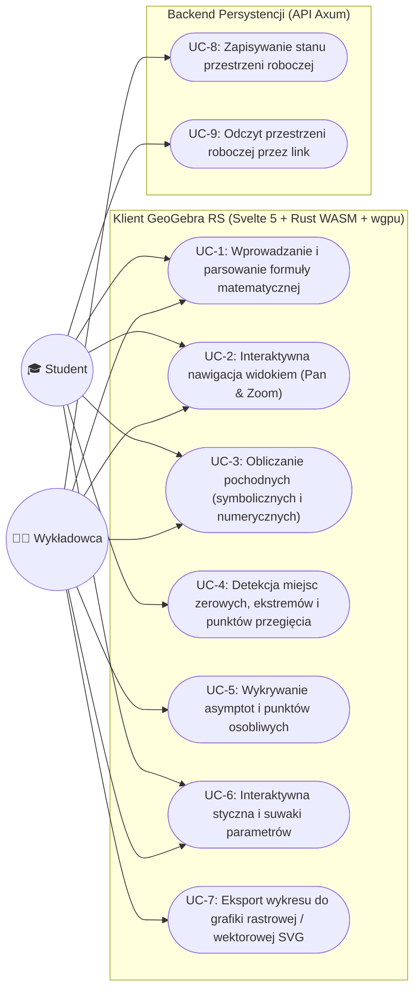
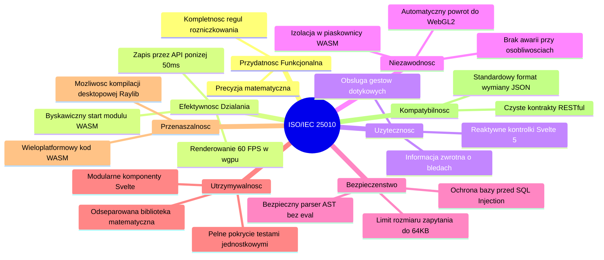

# PRD: GeoGebra RS (Platforma do Analizy Matematycznej i Wizualizacji Funkcji)

## 0. Cel Dokumentu
Niniejszy dokument definiuje wymagania produktowe i techniczne dla projektu **GeoGebra RS** – interaktywnej platformy do wizualizacji i badania funkcji matematycznych o wysokiej wydajności. Przekłada potrzeby studentów i wykładowców akademickich na formalne Wymagania Funkcjonalne (FR), 5 kluczowych historyjek użytkownika (User Stories) zgodnych z kryteriami **INVEST** oraz schematem **GIVEN-WHEN-THEN**, diagram przypadków użycia UML oraz wymagania niefunkcjonalne (NFR) ustrukturyzowane według **międzynarodowego standardu jakości oprogramowania ISO/IEC 25010**.

Odbiorcy dokumentu:
- Architektura Systemu (`bmad-architecture` / Winston)
- Projektowanie Doświadczeń Użytkownika (`bmad-ux` / Sally)
- Podział Zadań i Implementacja (`bmad-agent-po` Sofia, `bmad-agent-dev` Amelia)
- Zapewnienie Jakości i Testy Akceptacyjne (`bmad-tea` Murat)

---

## 1. Wizja Produktu
Dostępne na rynku programy do algebry komputerowej i rysowania wykresów (np. GeoGebra, WolframAlpha) często cierpią na opóźnienia sieciowe, wymagają instalacji ociężałych aplikacji natywnych lub ukrywają analizę krok po kroku za płatnymi subskrypcjami.

**GeoGebra RS** dostarcza bezkompromisowo szybkie, pozbawione opóźnień środowisko do analizy matematycznej i rysowania wykresów, działające bezpośrednio w przeglądarce oraz jako lekka aplikacja natywna. Poprzez przeniesienie 100% obliczeń analitycznych i numerycznych do WebAssembly (skompilowanego z języka Rust) oraz akcelerowane sprzętowo renderowanie przez bibliotekę `wgpu`, GeoGebra RS zapewnia idealnie płynne 60 klatek na sekundę (60 FPS) i natychmiastowe wyliczanie pochodnych symbolicznych. Rola backendu (Rust Axum) została celowo ograniczona wyłącznie do roli ultralekkiego magazynu persystencji, służącego do zapisywania i udostępniania linków do przestrzeni roboczych (workspaces).

---

## 2. Grupy Docelowe i Persony

### 2.1 Persona 1: Alex / Piotr (Student Kierunku Ścisłego / Technicznego)
* **Profil:** Student politechniki, uniwersytetu lub uczeń szkoły średniej realizujący rozszerzony program matematyki (analiza matematyczna, rachunek różniczkowy).
* **Kontekst:** Przygotowanie do kolokwiów i egzaminów, rozwiązywanie zadań domowych, chęć intuicyjnego zrozumienia pojęć abstrakcyjnych (ciągłość funkcji, granice, tempo zmian, wypukłość).
* **Zadania do zrealizowania (Jobs To Be Done - JTBD):**
  - Błyskawiczne wykreślanie skomplikowanych funkcji bez uciążliwej konfiguracji czy restrykcyjnych błędów składni.
  - Zrozumienie, *dlaczego* w danym punkcie występuje ekstremum lub punkt przegięcia, poprzez jednoczesną obserwację funkcji i jej pochodnych.
  - Eksperymentowanie z parametrami za pomocą suwaków zmiennych ($k, a, b$) bez najmniejszych przycięć animacji.
* **Problemy i frustracje:** Ociężałe wykresy internetowe, zacinające się suwaki parametrów, błędy połączenia z serwerem na uczelnianym Wi-Fi, nieczytelne komunikaty o błędach w formule.

### 2.2 Persona 2: Dr Nowak / Prof. Elena (Wykładowca / Prowadzący Ćwiczenia)
* **Profil:** Nauczyciel akademicki prowadzący wykłady z analizy matematycznej lub nauczyciel matematyki w szkole średniej.
* **Kontekst:** Prezentacja zagadnień na projektorze w auli wykładowej, przygotowywanie ilustracji do skryptów i list zadań, demonstracja pojęć granicznych i stycznych w czasie rzeczywistym.
* **Zadania do zrealizowania (Jobs To Be Done - JTBD):**
  - Prowadzenie dynamicznych demonstracji na żywo (np. zbieganie siecznej do stycznej, zachowanie funkcji przy asymptotach) z idealną płynnością 60 FPS.
  - Generowanie rzetelnych matematycznie wykresów z automatycznym oznaczeniem punktów charakterystycznych (miejsca zerowe, ekstrema, punkty przegięcia).
  - Błyskawiczne zapisanie stanu tablicy i wygenerowanie krótkiego linku, który studenci mogą od razu otworzyć na swoich urządzeniach.
* **Problemy i frustracje:** Narzędzia rysujące błędne pionowe linie łączące w miejscach asymptot pionowych (dzielenie przez zero), brak oznaczania punktów nieciągłości, skomplikowany proces eksportu i zapisu.

---

## 3. Historyjki Użytkownika (Zasady INVEST i Format GIVEN-WHEN-THEN)

Poniższe 5 kluczowych historyjek spełnia reguły **INVEST** (Niezależne, Negocjowalne, Wartościowe, Szacowalne, Małe, Testowalne) i definiuje bazowy zakres projektu:

### Historyjka 1: Rysowanie Wykresu i Płynna Nawigacja Widokiem
> **Jako** student lub wykładowca,  
> **Chcę** wprowadzić wzór funkcji analitycznej oraz płynnie przesuwać i przybliżać układ współrzędnych,  
> **Aby** intuicyjnie zbadać lokalne i globalne zachowanie funkcji.
* **Kryteria Akceptacji (GIVEN-WHEN-THEN / DANE-GDY-WTEDY):**
  - **Mając (Given)** aktywną sesję GeoGebra RS,
  - **Gdy (When)** użytkownik wpisze w polu formuły `f(x) = x^3 - 3*x + 1` i zatwierdzi klawiszem Enter,
  - **Wtedy (Then)** płótno `wgpu` wyrenderuje ciągłą krzywą w bieżącym obszarze widocznym w czasie $< 16\text{ ms}$ ($< 1$ klatki), dynamicznie dostosowując gęstość podziałki siatki i etykiety osi podczas przewijania kółkiem myszy (zoom) oraz przeciągania kursorem (pan).

### Historyjka 2: Obliczanie Pierwszej i Drugiej Pochodnej oraz Badanie Stycznej
> **Jako** student analizy matematycznej,  
> **Chcę** automatycznie wyznaczyć wzory $f'(x)$ i $f''(x)$ oraz badać prostą styczną w wybranym punkcie $x_0$,  
> **Aby** wizualnie powiązać nachylenie krzywej z wartością jej pochodnej.
* **Kryteria Akceptacji (GIVEN-WHEN-THEN / DANE-GDY-WTEDY):**
  - **Mając (Given)** wykreśloną funkcję $f(x)$ i włączony znacznik inspekcji w punkcie $x_0 = 1.5$,
  - **Gdy (When)** użytkownik zaznaczy opcję „Pokaż pochodną” i przesunie suwak punktu $x_0$,
  - **Wtedy (Then)** silnik w WASM wyznaczy postać symboliczną pochodnej, wyrenderuje krzywą $f'(x)$ linią przerywaną oraz wyświetli prostą styczną $y = f'(x_0)(x - x_0) + f(x_0)$, poruszającą się synchronicznie w czasie rzeczywistym z płynnością 60 FPS.

### Historyjka 3: Automatyczna Detekcja Miejsc Zerowych, Ekstremów i Punktów Przegięcia
> **Jako** student rozwiązujący zadanie z badania przebiegu zmienności funkcji,  
> **Chcę** automatycznie zlokalizować pierwiastki, ekstrema lokalne i punkty przegięcia na widocznym przedziale,  
> **Aby** zweryfikować poprawność moich obliczeń analitycznych.
* **Kryteria Akceptacji (GIVEN-WHEN-THEN / DANE-GDY-WTEDY):**
  - **Mając (Given)** funkcję różniczkowalną $f(x)$ na przedziale $[x_{\min}, x_{\max}]$,
  - **Gdy (When)** użytkownik kliknie przycisk „Zbadaj właściwości funkcji”,
  - **Wtedy (Then)** silnik Rust WASM wyznaczy miejsca zerowe ($f(x) = 0$), punkty stacjonarne ($f'(x) = 0$) oraz punkty przegięcia ($f''(x) = 0$), nanosząc na wykres wyróżnione punkty z dokładnymi współrzędnymi widocznymi po najechaniu kursorem (tooltip).

### Historyjka 4: Wykrywanie Osobliwości, Nieciągłości i Asymptot
> **Jako** wykładowca matematyki,  
> **Chcę**, aby aplikacja poprawnie rozpoznawała i wykreślała asymptoty pionowe, poziome i ukośne bez artefaktów graficznych,  
> **Aby** moi studenci nie mylili osobliwości z gwałtownymi zmianami funkcji ciągłej.
* **Kryteria Akceptacji (GIVEN-WHEN-THEN / DANE-GDY-WTEDY):**
  - **Mając (Given)** funkcję wymierną, np. $f(x) = \frac{x^2 - 1}{x - 2}$,
  - **Gdy (When)** funkcja jest ewaluowana na zadanym przedziale,
  - **Wtedy (Then)** silnik wykrywa asymptotę pionową w $x = 2$, zapobiega błędnemu łączeniu punktów pionową kreską przez nieskończoność i nanosi przerywaną linię asymptoty pionowej oraz asymptotę ukośną $y = x + 2$.

### Historyjka 5: Lekkie Zapisywanie i Udostępnianie Stanu przez API Axum
> **Jako** wykładowca przygotowujący materiały do zajęć,  
> **Chcę** zapisać zdefiniowane funkcje, parametry i widok, aby otrzymać unikalny krótki adres URL,  
> **Aby** studenci mogli jednym kliknięciem otworzyć dokładnie taką samą demonstrację na swoich laptopach.
* **Kryteria Akceptacji (GIVEN-WHEN-THEN / DANE-GDY-WTEDY):**
  - **Mając (Given)** skonfigurowany obszar roboczy z wieloma funkcjami i ustawionym widokiem,
  - **Gdy (When)** użytkownik kliknie „Udostępnij przestrzeń roboczą”,
  - **Wtedy (Then)** interfejs Svelte serializuje stan do formatu JSON i wykonuje zapytanie `POST /api/workspaces` do API Axum; backend zwraca krótki identyfikator w czasie $< 50\text{ ms}$, a użytkownik otrzymuje link pozwalający na identyczne odtworzenie widoku po stronie klienta.

---

## 4. Diagram Przypadków Użycia UML (Use Case)



---

## 5. Granice Architektoniczne Systemu

Zgodnie z ustaleniami architektonicznymi, system realizuje ścisły podział na **Obliczenia Klienckie** oraz **Serwerową Persystencję**:

```
+-------------------------------------------------------------------------------+
|                           KLIENT (Przeglądarka / WASM)                        |
|                                                                               |
|  +---------------------------+        +------------------------------------+  |
|  |     Svelte 5 (UI/UX)      |        |        Rdzeń Rust WebAssembly      |  |
|  | - Pasek wprowadzania      | <----> | - Parser AST (nom / pest)          |  |
|  | - Reaktywny stan (runes)  |        | - Silnik pochodnych symbolicznych  |  |
|  | - Powiązania suwaków      |        | - Solver numeryczny pierwiastków   |  |
|  +---------------------------+        +------------------------------------+  |
|               |                                         |                     |
|               v                                         v                     |
|  +-------------------------------------------------------------------------+  |
|  |                     Potok Graficzny wgpu                                |  |
|  | - Bufory wierzchołków GPU do próbkowania krzywych (płynne 60 FPS)       |  |
|  | - Główny backend WebGPU z automatycznym powrotem do WebGL2              |  |
|  +-------------------------------------------------------------------------+  |
+---------------------------------------+---------------------------------------+
                                        | (Wyłącznie przy Zapisie / Odczycie)
                                        | Protokół HTTP REST (Format JSON)
                                        v
+-------------------------------------------------------------------------------+
|                            BACKEND (API REST Axum)                            |
|                                                                               |
|  - POST /api/workspaces -> Generuje 8-znakowy identyfikator przestrzeni       |
|  - GET  /api/workspaces/:slug -> Zwraca zserializowane drzewo wyrażeń i widok |
|  - Zero obliczeń matematycznych; wyłącznie ultraszybki magazyn danych JSON    |
+-------------------------------------------------------------------------------+
```

---

## 6. Słownik Pojęć (Glossary)

* **AST (Abstract Syntax Tree / Abstrakcyjne Drzewo Składniowe):** Hierarchiczna reprezentacja wyrażenia matematycznego w pamięci podręcznej programu, powstała w wyniku parsowania tekstu zapisanego przez użytkownika.
* **Pochodna Symboliczna (Symbolic Derivative):** Analityczne, dokładne wyznaczenie funkcji pochodnej (np. $\frac{d}{dx}(\sin(x)) = \cos(x)$) w oparciu o reguły różniczkowania algebry komputerowej.
* **Aproksymacja Numeryczna (Numerical Fallback):** Dyskretne metody przybliżone (np. metoda różnic centralnych, metoda Brenta/Newtona-Raphsona) stosowane tam, gdzie postać analityczna jest nieosiągalna lub zbyt złożona.
* **wgpu:** Bezpieczna, wieloplatformowa biblioteka graficzna języka Rust obsługująca natywne API (Vulkan, Metal, DirectX 12) oraz przeglądarkowy standard WebGPU / WebGL2 poprzez WebAssembly.
* **Rzutnia (Viewport):** Prostokątny obszar dziedziny i zbioru wartości $[x_{\min}, x_{\max}] \times [y_{\min}, y_{\max}]$ odwzorowywany aktualnie na płaszczyznę pikseli na ekranie.
* **Punkt Krytyczny (Critical Point):** Punkt dziedziny, w którym pochodna funkcji jest równa zero ($f'(x) = 0$) lub nie istnieje.
* **Punkt Przegięcia (Inflection Point):** Punkt, w którym funkcja zmienia swoją wypukłość (z wypukłej na wklęsłą lub odwrotnie), zazwyczaj wyznaczany przez $f''(x) = 0$ ze zmianą znaku drugiej pochodnej.

---

## 7. Wymagania Funkcjonalne

### 7.1 Parser i Ewaluacja Wyrażeń (`FR-PARSE`)
* **FR-1:** Klient MUSI poprawnie parsować typowe wyrażenia matematyczne: wielomiany, funkcje trygonometryczne, wykładnicze, logarytmiczne i wymierne.
  * *Testowalna Konsekwencja:* Wpisanie niepoprawnej składni (np. `x^^2 + (`) powoduje podświetlenie dokładnego indeksu znaku błędu w polu tekstowym, nie przerywając pętli renderowania programu.
* **FR-2:** Parser MUSI obsługiwać parametry zmienne definiowane przez użytkownika (np. $f(x) = a \cdot x^2 + b$) sprzężone reaktywnie z suwakami w interfejsie użytkownika.

### 7.2 Moduł Analityczny i Rachunek Różniczkowy (`FR-CALC`)
* **FR-3:** Silnik WASM MUSI wyznaczać pierwszą i drugą pochodną symboliczną dla wszystkich wspieranych funkcji różniczkowalnych.
* **FR-4:** Silnik MUSI wyznaczać równanie i współrzędne prostej stycznej w zadanym punkcie $x_0$ z natychmiastową aktualizacją wartości przy zmianie $x_0$.
* **FR-5:** Silnik MUSI wykrywać rzeczywiste miejsca zerowe funkcji $f(x)$ w widocznym oknie rzutni przy użyciu kombinacji solvera analitycznego oraz metody Brenta.
* **FR-6:** Silnik MUSI precyzyjnie wyznaczać ekstrema lokalne (minima/maksima) oraz punkty przegięcia funkcji w obrębie bieżącej rzutni.
* **FR-7:** Silnik MUSI identyfikować asymptoty pionowe, poziome i ukośne ($y = ax + b$) oraz eliminować zjawisko fałszywych linii łączących w punktach nieciągłości.

### 7.3 Potok Wizualizacji Graficznej (`FR-RENDER`)
* **FR-8:** Wykresy funkcji MUSZĄ być renderowane z użyciem biblioteki `wgpu` z adaptacyjnym próbkowaniem podpikselowym, gwarantującym gładkość linii krzywej niezależnie od stopnia jej nachylenia.
* **FR-9:** Płótno wykresu MUSI zapewniać płynne przesuwanie i przybliżanie z prędkością 60 FPS, automatycznie przeliczając podziałki siatki i etykiety osi.
* **FR-10:** Rysowanie wielu wykresów MUSI wspierać odrębne style linii (ciągła, przerywana), konfigurowalną paletę kolorystyczną oraz przełączniki widoczności poszczególnych pochodnych.

### 7.4 Persystencja i API Zapisywania (`FR-API`)
* **FR-11:** Interfejs Svelte MUSI serializować pełny stan sesji (wzory, wartości suwaków, współrzędne rzutni) do zwięzłego formatu JSON o rozmiarze $< 10\text{ KB}$.
* **FR-12:** Serwis Axum MUSI udostępniać endpointy `POST /api/workspaces` oraz `GET /api/workspaces/:id` o czasie odpowiedzi $< 50\text{ ms}$.

---

## 8. Wymagania Jakościowe według Normy ISO/IEC 25010

Wymagania niefunkcjonalne zorganizowano według 8 głównych charakterystyk jakościowych modelu ISO/IEC 25010:



| Kategoria ISO/IEC 25010 | Identyfikator | Specyfikacja i Wartość Docelowa |
| :--- | :--- | :--- |
| **Przydatność Funkcjonalna (Functional Suitability)** | `NFR-FUNC-01` | Obliczenia zmiennoprzecinkowe muszą być zgodne ze standardem IEEE 754 (podwójna precyzja f64) z błędem tolerancji $\epsilon < 10^{-12}$. |
| **Efektywność Działania (Performance Efficiency)** | `NFR-PERF-01` | Wyznaczenie punktów krzywej i odświeżenie bufora GPU dla 2000 próbek musi zająć $< 8\text{ ms}$. |
| **Efektywność Działania (Performance Efficiency)** | `NFR-PERF-02` | Pętla renderowania `wgpu` musi utrzymywać stałe 60 FPS podczas ciągłego przesuwania i skalowania widoku przez użytkownika. |
| **Użyteczność (Usability)** | `NFR-USAB-01` | Informacja o błędzie składniowym w formule musi pojawiać się w czasie $< 50\text{ ms}$ od momentu zatrzymania wpisywania tekstu. |
| **Niezawodność (Reliability)** | `NFR-RELI-01` | Wprowadzenie funkcji z punktami osobliwymi (np. `1/x`, `tan(x)`) nie może wywołać błędu panic w Rust, propagacji wartości NaN w buforach ani utraty kontekstu GPU. |
| **Niezawodność (Reliability)** | `NFR-RELI-02` | W przypadku braku dostępności WebGPU w przeglądarce klienta silnik musi automatycznie przełączyć się na WebGL2 bez przerwania działania aplikacji. |
| **Bezpieczeństwo (Security)** | `NFR-SECU-01` | Wprowadzane wzory muszą być interpretowane wyłącznie przez bezpieczny parser AST; jakiekolwiek wywołania typu `eval` lub wykonywanie obcego kodu są bezwzględnie zablokowane. |
| **Bezpieczeństwo (Security)** | `NFR-SECU-02` | API Axum musi odrzucać żądania o rozmiarze przekraczającym $64\text{ KB}$ w celu ochrony przed atakami typu Denial of Service (DoS). |
| **Utrzymywalność (Maintainability)** | `NFR-MAIN-01` | Rdzenny silnik matematyczny w Rust musi być niezależną biblioteką (crate), kompilującą się bez zależności graficznych czy przeglądarkowych. |
| **Przenaszalność (Portability)** | `NFR-PORT-01` | Wersja przeglądarkowa musi działać bezbłędnie na wiodących przeglądarkach (Chromium, Firefox, Safari) na komputerach oraz tabletach. |

---

## 9. Zakres MVP i Elementy Poza Zakresem (Non-Goals)

### 9.1 Zakres Pierwszej Wersji (W Scope MVP)
* Parsowanie i wykreślanie funkcji jawnych w przestrzeni dwuwymiarowej $y = f(x)$.
* Obliczanie pierwszej i drugiej pochodnej symbolicznej wraz z dynamiczną prostą styczną.
* Automatyczna detekcja i graficzne oznaczanie miejsc zerowych, ekstremów lokalnych i punktów przegięcia.
* Płynne przesuwanie i skalowanie widoku w `wgpu` z dynamiczną adaptacją podziałki siatki.
* Interfejs Svelte 5 z reaktywnymi suwakami parametrów.
* Zapisywanie i odtwarzanie przestrzeni roboczej za pośrednictwem lekkiego API Axum.

### 9.2 Elementy Poza Zakresem MVP (Przyszłe Wersje)
* **NON-GOAL (MVP):** Trójwymiarowe wykresy funkcji dwóch zmiennych, np. `$z = f(x, y)$`.
* **NON-GOAL (MVP):** Wykresy funkcji uwikłanych (takich jak `$x^2 + y^2 = r^2$`) oraz krzywych parametrycznych.
* **NON-GOAL (MVP):** Rejestracja kont użytkowników, logowanie, hasła czy uprawnienia zespołowe.
* **NON-GOAL (MVP):** Pełny uniwersalny system algebry komputerowej (np. zaawansowana faktoryzacja wielomianów wysokich stopni).

---

## 10. Metryki Sukcesu Projektu

* **SM-1 (Płynność Interakcji):** 95% sesji użytkowników zachowuje wskaźnik $\ge 58\text{ FPS}$ podczas ciągłego przesuwania i przybliżania wykresu.
* **SM-2 (Poprawność Obliczeniowa):** 100% zaliczonych testów w automatycznym zestawie weryfikującym 250 wzorcowych funkcji analitycznych.
* **SM-3 (Wydajność API):** 99. percentyl operacji zapisu przestrzeni roboczej kończy się w czasie poniżej $100\text{ ms}$.
* **Antymetryka (Counter-Metric SM-C1):** Nie wolno obniżać precyzji obliczeń ani gęstości próbkowania krzywej wyłącznie w celu sztucznego skrócenia czasu klatki poniżej $1\text{ ms}$ – poprawność matematyczna ma zawsze pierwszeństwo przed nadmiarową optymalizacją.

---

## 11. Indeks Założeń i Otwarte Pytania

### Założenia Projektowe
* `[ZAŁOŻENIE-01]` Przeglądarki docelowych użytkowników wspierają WebGPU lub co najmniej WebGL2 do obsługi `wgpu`.
* `[ZAŁOŻENIE-02]` Baza danych w API Axum (SQLite lub lekki PostgreSQL) przechowuje stany robocze bez konieczności uwierzytelniania użytkowników.
* `[ZAŁOŻENIE-03]` Programy nauczania matematyki w szkołach i na uczelniach koncentrują się w pierwszej kolejności na badaniu funkcji jawnych $y = f(x)$.

### Otwarte Pytania
1. Czy wygenerowane linki do przestrzeni roboczych powinny wygasać po określonym czasie (np. 90 dni braku aktywności), czy mają być przechowywane bezterminowo?
2. Czy w ramach MVP dodać opcję natychmiastowego eksportu wykresu do pliku wektorowego SVG bezpośrednio z silnika WASM na potrzeby publikacji naukowych i sprawozdań?
