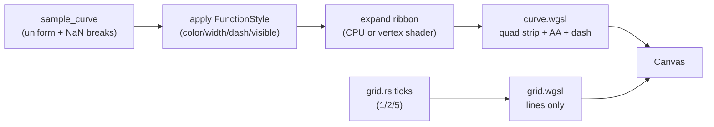
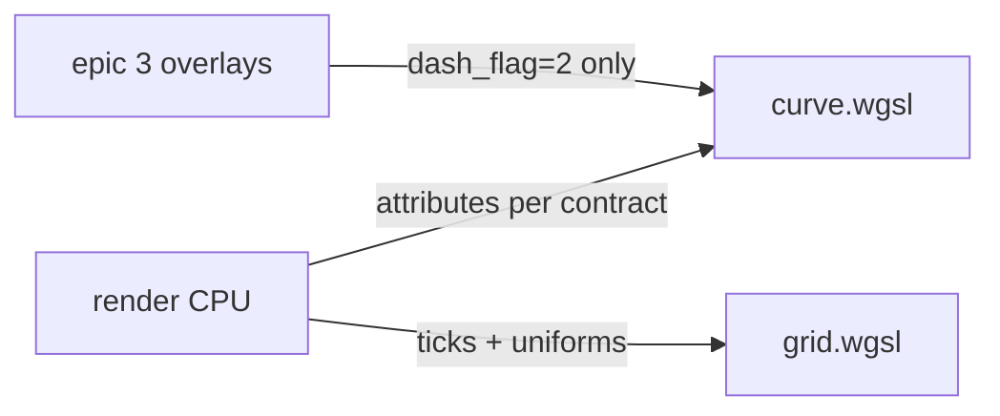

# Architecture Delta — Epic Rendering Polish (R8, R9, R10)

## Design Paradigm

Inherited Pipes-and-Filters: `Sample (curve.rs) → Expand to ribbon → Submit to GPU (pipeline.rs) → Canvas`.
Epic 4 owns the last two stages' polish. No new paradigm; style is data
carried through the pipe, never a side channel.



## Inherited Invariants

| Inherited | From parent | Binds here |
| --- | --- | --- |
| AD-1 4-crate 1-way deps | architecture-geogebra-rs | `render` gains `wgpu` dep in story 1.2; `core_math` stays web-free; style struct lives in `render`, not `wasm_bridge` |
| AD-2 Pratt + Span | architecture-geogebra-rs | No parser work in this epic |
| AD-3 diff+simplify+Brent | architecture-geogebra-rs | Derivative *values* come from AD-3 pipeline; this epic only styles their overlays |
| AD-4 GPU-geometry / Svelte-text split | architecture-geogebra-rs | **Amended below (E4-AD-4-AMEND)** — ribbon widths, dash, grid ownership |
| AD-5 WASM named surface | architecture-geogebra-rs | **Amended below (E4-AD-5-AMEND)** — count fix + style fns |
| AD-6 Axum blob store | architecture-geogebra-rs | Workspace JSON carries style fields; no backend change |
| f64 CPU / f32 GPU convention | architecture-geogebra-rs | Sampler + viewport math in f64; vertex buffers + WGSL in f32 |
| WGSL-only shader source | architecture-geogebra-rs | `curve.wgsl` + `grid.wgsl`, GL-translatable subset (see E4-GL-PARITY) |

## Invariants & Rules

### E4-AD-4-AMEND — Quad-ribbon curves with clamped width (amends parent AD-4)

- **Binds:** R8, R10 — `render/curve.rs`, `render/shaders/curve.wgsl`, `render/pipeline.rs`
- **Prevents:** `wgpu` 1-px hairlines returning via raw polylines; per-story width drift
- **Rule:** All curves render as quad-ribbon triangle strips expanded in the
  `curve.wgsl` vertex shader, with edge antialiasing in the fragment shader.
  Width is a per-vertex `width_px` attribute, clamped in-shader to
  **[2.5 px min, 6.0 px max]**, default **3.5 px**. Minimum 2.5 px stroke
  always holds on both WebGPU and WebGL2. [ADOPTED 2026-10-18]

### E4-DASH — Screen-space dashed derivatives

- **Binds:** R10 — `curve.wgsl` fragment shader, `FunctionStyle.dashed`
- **Prevents:** two stories inventing incompatible dash encodings (uniform flag vs separate pipeline)
- **Rule:** `f(x)` solid; `f′(x)` / `f″(x)` dashed via screen-space pattern in
  the fragment shader: **8 px on / 6 px off at 1×**, computed from a
  `arclength_px` varying, antialiased at dash edges, DPR-aware.
  Dash flag travels per-vertex (`0.0` solid, `1.0` dashed);
  `dash_flag = 2.0` is **reserved for epic 3** asymptote overlays and MUST NOT
  be emitted by epic 4 code; conversely epic 3 MUST use only `dash_flag = 2.0`
  and MUST NOT emit `0.0`/`1.0`. [ADOPTED 2026-10-18]

### E4-STYLE-STRUCT — Per-function style owned by `render`

- **Binds:** R10 — `render/curve.rs`, `wasm_bridge` Session, Svelte style controls
- **Prevents:** Svelte holding parallel style truth; colour/width shape drift between stories
- **Rule:** `render` owns:
  ```rust
  pub struct FunctionStyle {
      pub color: [f32; 4],   // linear-sRGB, premultiplied-alpha off
      pub width_px: f32,     // clamped [2.5, 6.0], default 3.5
      pub dashed: bool,      // false for f(x), true for derivatives
      pub visible: bool,     // false skips submission, keeps stored style
  }
  ```
  Keyed by function id in the `wasm_bridge` Session map. The vertex buffer
  carries colour + width + dash per vertex. Visibility `false` skips buffer
  submission for that id — it never deletes or mutates the stored style.

### E4-PALETTE — 8-colour default, user-overridable

- **Binds:** R10 — style defaults, Svelte palette control
- **Prevents:** ad-hoc per-story colour picks colliding on the 3-curve view
- **Rule:** Default **8-colour colourblind-safe palette**, assigned in order:
  `f` → `f′` → `f″` → further user functions cycle. User override via
  `set_function_style` replaces the entry. Exact hex values are an open
  question (Okabe-Ito vs Tailwind — Sofia to confirm); the *order rule* here
  is binding regardless. Width default 3.5 px. [ADOPTED 2026-10-18]

### E4-AD-5-AMEND — Style surface on the WASM ABI (amends parent AD-5)

- **Binds:** R10 — `wasm_bridge` `#[wasm_bindgen]` exports
- **Prevents:** unbounded WASM surface growth; Svelte coupling to Rust internals
- **Rule:** Parent AD-5 says "exactly four" but lists five — **count is fixed
  to five**, plus two style functions (Decision 2026-10-18):
  `set_function_style(id: &str, color_hex: &str, width_px: f64, dashed: bool)`
  and `set_function_visibility(id: &str, visible: bool)`
  (a single `toggle_visibility(id)` equivalent is acceptable if the bridge
  prefers it — one of the two shapes, not both). All other AD-5 rules stand:
  plain-JSON/plain-field types only, Rust owns live state, any further
  expansion requires an explicit AD amendment. [ADOPTED 2026-10-18]

### E4-SHADER-CONTRACT — `curve.wgsl` / `grid.wgsl` attribute layout (shared with epic 3)

- **Binds:** R8, R9 — `render/shaders/curve.wgsl`, `render/shaders/grid.wgsl`
- **Prevents:** shader signature collision between epic 3 and epic 4 builders
- **Rule:** `curve.wgsl` vertex input layout is frozen for this epic:
  `position_math: vec2f, normal_dir: vec2f, color: vec4f, width_px: f32,
  dash_flag: f32, arclength_px: f32`; uniforms: viewport rect (f32),
  `canvas_px: vec2f`, `dpr: f32`. `grid.wgsl` draws lines only (positions +
  single colour uniform) — **never text**. Epic 3 may draw asymptote overlays
  through the SAME `curve.wgsl` dashed path with `dash_flag = 2.0` (and only
  `2.0`); it MUST
  NOT change the attribute layout without an E4 amendment. No shaders exist
  yet (confirmed 2026-10-18) — first writer creates both files to this
  contract.



### E4-VIEWPORT-GRID — Viewport + ticks owned by Rust, labels by Svelte

- **Binds:** R9 — `render/viewport.rs`, `render/grid.rs`, `wasm_bridge`, Svelte overlay
- **Prevents:** dual viewport truth; canvas text-atlas bloat
- **Rule:** Rust owns viewport state (`wasm_bridge` Session via
  `update_viewport`) + tick computation (`grid.rs` 1/2/5 nice steps,
  `max_ticks = 10`) + grid vertex emission. Svelte renders ONLY axis tick
  labels and tooltips as a transparent DOM/SVG overlay, positioned from
  `viewport_ticks` / `query_hover` — never computing ticks or transforms
  itself. Grid geometry updates synchronously on viewport change; labels may
  lag one frame during continuous drag.

### E4-GL-PARITY — WebGL2-translatable WGSL only

- **Binds:** R9, NFR-PORT-01 — `pipeline.rs`, both shaders
- **Prevents:** a WebGPU-only shader silently breaking Safari
- **Rule:** All WGSL MUST compile under the `wgpu` WebGL2 (GLES3) translation:
  no subgroup ops, no texture features beyond the GLES3 subset, f32 only in
  shaders (f64 stays CPU-side). `pipeline.rs` requests
  `Backends::PRIMARY | Backends::GL` with silent WebGL2 retry (story 1.2).
  Curve and grid paths are identical on both backends; perf deltas are
  recorded, never branched.

### E4-PERF-HARNESS — How 60 FPS and 8 ms are proven

- **Binds:** R8, R9, NFR-PERF-01/02, SM-1 — harness, not product code
- **Prevents:** per-story perf claims on incomparable harnesses
- **Rule:** **60 FPS** = continuous drag/zoom script on current Chrome
  (WebGPU), Firefox (WebGPU), Safari (WebGL2 fallback) — same script, same
  trace, frame-time p95 < 16 ms. **8 ms** = native `cargo test`
  `two_thousand_points_are_fast` (existing) PLUS a WASM bench for the
  2000-point vertex buffer *including* ribbon expansion. Budget split:
  sampler < 8 ms, ribbon-expand + submit < 8 ms, total frame < 16 ms.
  [ADOPTED 2026-10-18]

### E4-SCOPE — Epic 3 / epic 4 boundary on shared `curve.rs`

- **Binds:** R7 vs R8/R10 — `render/curve.rs` (`POLE_BREAK`, NaN-break)
- **Prevents:** double ownership of singularity rendering
- **Rule:** Epic 3 owns pole-break/asymptote overlays (detection + overlay
  geometry via the reserved dash path). Epic 4 owns the style system +
  quad-ribbon + grid + perf harness. The shared `POLE_BREAK = 1e6` /
  NaN-break primitive in `curve.rs` is read-only for both epics — neither
  changes its semantics without a joint amendment.

## Consistency Conventions

| Concern | Convention |
| --- | --- |
| Style colour wire format | `color_hex: "#RRGGBB"` at ABI; converted to linear-sRGB `[f32;4]` inside `render` |
| Width clamping | Clamp at both layers: ABI validates `[2.5, 6.0]`, shader clamps again |
| Visibility | `visible=false` → skip submission; style entry retained for toggle-back |
| Dash units | Screen-space px at 1×, scaled by `dpr` uniform — never math-space |
| Grid ticks | 1/2/5 nice steps, `max_ticks = 10` per axis, zero-snapped (`grid.rs` as-is) |
| Viewport serialization | `{ x_min, x_max, y_min, y_max }` f64; style map serialized alongside in workspace JSON |
| Shader source | WGSL only; GL-translatable subset; `curve.wgsl` + `grid.wgsl` under `render/shaders/` |

## Stack

| Name | Version |
| --- | --- |
| Rust | 2024 edition |
| `wgpu` | 30.0.1 (lands story 1.2; not yet a dependency — confirmed 2026-10-18) |
| `wasm-bindgen` | 0.2.129 |
| Svelte | 5 (Runes GA) |

## Structural Seed

```text
crates/render/
  src/
    curve.rs      # sample_curve + FunctionStyle + ribbon expansion (E4 owns style+ribbon)
    grid.rs       # 1/2/5 ticks (E4 owns vertex emission; labels stay Svelte)
    viewport.rs   # unchanged; owned by wasm_bridge Session
    pipeline.rs   # PRIMARY|GL init (story 1.2); E4 adds ribbon/grid pipelines
  shaders/
    curve.wgsl    # NEW to E4-SHADER-CONTRACT (shared with epic 3, dash_flag=2 reserved)
    grid.wgsl     # NEW to E4-SHADER-CONTRACT (lines only, no text)
crates/wasm_bridge/
  src/lib.rs      # + set_function_style + set_function_visibility (E4-AD-5-AMEND)
frontend/src/
  Canvas.svelte        # canvas mount, viewport events
  StyleControls.svelte # NEW: palette / width / dash / visibility → style fns
  Tooltip.svelte       # unchanged overlay role
```

## Capability → Architecture Map

| Capability | Lives in | Governed by |
| --- | --- | --- |
| R8 quad-ribbon + AA, 8 ms buffer | `render/curve.rs`, `curve.wgsl` | E4-AD-4-AMEND, E4-SHADER-CONTRACT, E4-PERF-HARNESS |
| R9 adaptive grid + 60 FPS pan/zoom | `render/grid.rs`, `grid.wgsl`, `pipeline.rs` | E4-VIEWPORT-GRID, E4-GL-PARITY, E4-PERF-HARNESS |
| R10 palette / dash / visibility | `FunctionStyle`, style ABI fns, `StyleControls.svelte` | E4-STYLE-STRUCT, E4-PALETTE, E4-DASH, E4-AD-5-AMEND |
| R7 boundary (not in scope) | epic 3 overlays via reserved path | E4-SCOPE, E4-SHADER-CONTRACT |

## Deferred

- Exact 8-colour hex values → Sofia/user pick (open question in memlog).
- WASM bench harness shape (`wasm-bindgen-test` vs `performance.now()` script) → build-agent pick at slice time.
- Adaptive curvature subdivision (beyond uniform sampler) → story-level detail, not an epic invariant.
- Native `winit` desktop target → post-MVP per parent spine.
